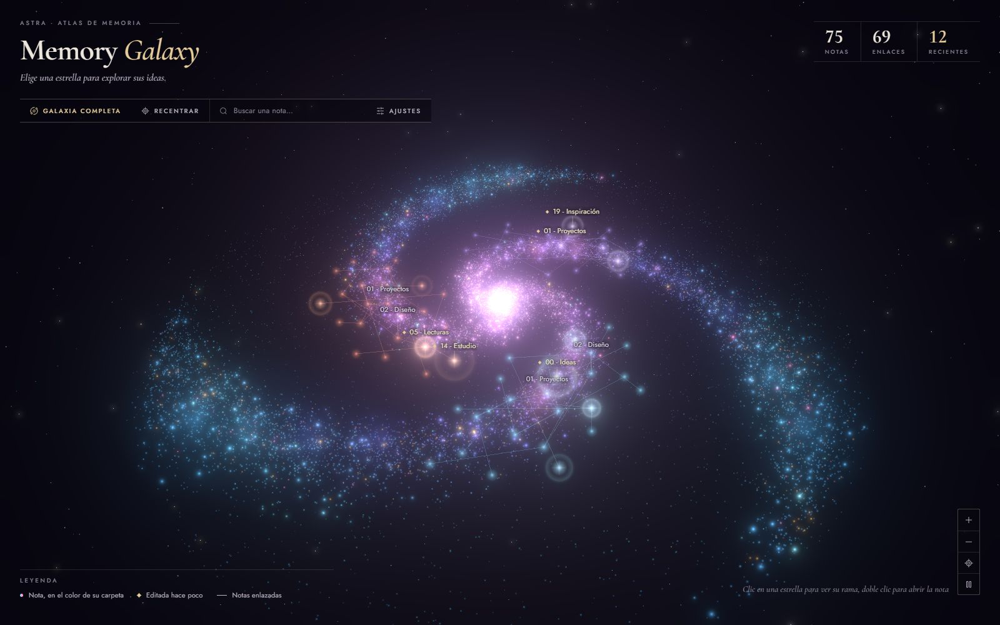
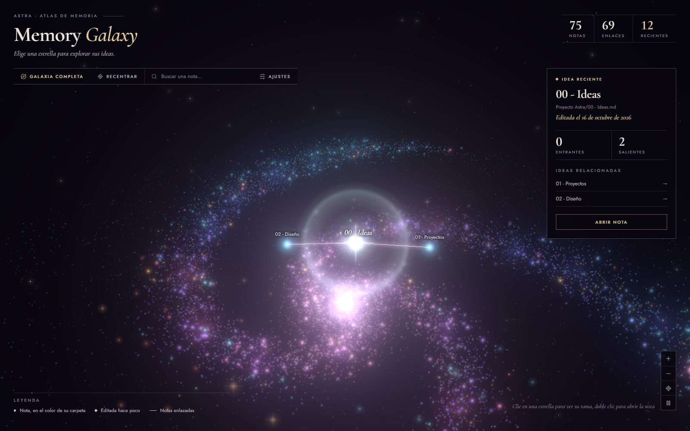

# Astra Memory Galaxy para Obsidian

Tus notas de Obsidian como una galaxia espiral en 3D. Cada nota es una estrella, cada grupo de notas enlazadas forma una constelación sobre un brazo de la galaxia, y las ideas que editaste hace poco brillan más que el resto.

## Cómo se ve

**Vista general.** Un núcleo cálido, tres brazos de polvo estelar que pasan del rosa y violeta al cian, nebulosas suaves y un resplandor (bloom) que hace que cada estrella irradie luz. Las notas enlazadas se unen con líneas tenues del color de su carpeta. Las notas sin enlaces quedan como estrellas sueltas en los brazos exteriores.

**Ideas recientes.** Las 12 notas editadas más recientemente (en los últimos 30 días) brillan en blanco cálido, tienen destellos en cruz, laten y emiten un anillo de luz. Sus nombres aparecen primero, marcados con un rombo dorado.

**Al elegir una idea.** La galaxia se oscurece, la nota y sus vecinas flotan sobre el disco unidas por su rama, y a la derecha se abre su ficha: carpeta, ruta, fecha de edición, enlaces entrantes y salientes, ideas relacionadas y un botón para abrirla.

Las capturas salen de la vista previa (`npm run demo`), que usa el mismo marcado y los mismos estilos que el plugin.

## Diseño

La interfaz está pensada como un **instrumento de observatorio o un atlas estelar impreso**, no como un panel genérico:

- **Filetes en lugar de cajas.** Barra de herramientas, cifras, leyenda y ficha se separan con líneas de 1 px. No hay botones-píldora, degradados ni vidrio esmerilado.
- **Un solo acento.** Un dorado cálido marca lo importante: la acción principal, las ideas recientes, la fecha de edición y los valores de los ajustes. Todo lo demás es tinta clara sobre el cielo.
- **Etiquetas de atlas.** Los nombres van sobre el cielo, sin fondo, unidos a su estrella por una línea guía. La idea elegida se rotula en cursiva serif, como en las cartas celestes antiguas.
- **Tipografía.** **Jost** (versión libre de Futura, la letra de la placa del Apolo 11) para la interfaz, las etiquetas y los datos, en versalitas espaciadas para los rótulos. **Cormorant Garamond**, inspirada en los atlas grabados, para el título, las cifras y la ficha. Ambas van incrustadas en `main.js` (ver `fonts/`) y funcionan sin conexión.

## Controles

- Arrastra para girar la cámara alrededor de la galaxia; clic derecho y arrastre para desplazarla.
- Usa la rueda o los botones `+` y `−` para acercar o alejar.
- Pulsa una estrella o su nombre para desplegar e iluminar solo sus relaciones directas. Pulsa otra idea relacionada para explorar su rama.
- Haz doble clic en una estrella para abrir su nota.
- Busca una nota por nombre o ruta para enfocar su estrella.
- **Recentrar** cierra la rama y vuelve al encuadre inicial; **Galaxia completa** aleja la cámara para verla entera.
- El botón de pausa detiene y reanuda el giro automático.
- **Ajustes** cambia la separación, el brillo (también controla el resplandor), las constelaciones, las ramas y cuántos nombres se muestran.

Las conexiones usan los enlaces que Obsidian resuelve entre archivos Markdown. Una nota sin enlaces sigue apareciendo como estrella independiente, pero no recibe hilos inventados. Cada estrella que puedes pulsar es una nota; el polvo de los brazos es solo decoración.

La escena se dibuja localmente con WebGL. No envía datos ni necesita servicios externos.

## Instalar o actualizar en una bóveda

1. Ejecuta `npm install` y `npm run build` en este proyecto.
2. Copia `manifest.json`, `main.js` y `styles.css` a `<tu bóveda>/.obsidian/plugins/astra-galaxy/`, reemplazando la versión anterior si la hay.
3. En Obsidian, abre **Preferencias → Complementos comunitarios**. Si aparece **Salir del modo restringido**, debes hacerlo tú para permitir plugins de la comunidad. Habilita **Astra Galaxy**; si ya estaba activo, desactívalo y vuelve a activarlo (o reinicia Obsidian) para cargar la versión nueva.
4. Abre la vista con el icono de órbita o con el comando **Abrir galaxia 3D**.

Para desarrollar dentro de una bóveda, coloca este proyecto en su carpeta de plugins y usa `npm run dev`.

## Vista previa sin abrir Obsidian

Ejecuta `npm run demo` y abre `http://127.0.0.1:4173` en el navegador. La vista previa usa 75 notas de muestra en tres grupos, 69 enlaces y 12 ideas recientes. Añade `?still` a la URL para detener el movimiento o `?focus` para abrir una rama con su ficha. Detén el servidor con `Ctrl+C` cuando termines.
